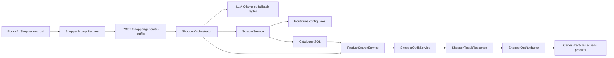

# AI Shopper Wearia — explication technique

Ce document décrit l’AI Shopper tel qu’il est implémenté dans Wearia : les écrans Android, le trajet d’une requête, l’interprétation de la demande, la collecte de produits, le calcul du budget, la composition des tenues et les limites connues. Il sert de guide de lecture du code, pas de promesse que chaque source Internet répond à chaque requête.

## 1. Résumé

L’AI Shopper est une fonctionnalité Android reliée à l’API FastAPI du projet. L’application envoie les critères au serveur. Celui-ci interprète le texte libre, actualise les boutiques configurées, filtre les offres réelles qu’il a pu vérifier, compose jusqu’à trois tenues et renvoie les données des articles. Android affiche les tenues et ouvre les URL des produits dans une application externe.

## 2. Où lire le code

| Rôle | Fichier |
|---|---|
| Écran, choix de l’occasion, budget et envoi | [`ShoppingFragment.kt`](../Wearia_Mobile/app/src/main/java/com/wearia/app/ui/shopping/ShoppingFragment.kt) |
| Mise en page de l’écran et cartes d’occasion | [`fragment_shopping.xml`](../Wearia_Mobile/app/src/main/res/layout/fragment_shopping.xml) |
| État de génération et exclusions de régénération | [`ShopperViewModel.kt`](../Wearia_Mobile/app/src/main/java/com/wearia/app/viewmodel/ShopperViewModel.kt) |
| Appel HTTP Android | [`ShopperRepository.kt`](../Wearia_Mobile/app/src/main/java/com/wearia/app/repositories/ShopperRepository.kt) et [`ApiService.kt`](../Wearia_Mobile/app/src/main/java/com/wearia/app/data/remote/ApiService.kt) |
| Objets JSON Android | [`Dtos.kt`](../Wearia_Mobile/app/src/main/java/com/wearia/app/data/remote/dto/Dtos.kt) |
| Affichage des propositions, favoris et navigation vers le produit | [`ShopperOutfitAdapter.kt`](../Wearia_Mobile/app/src/main/java/com/wearia/app/ui/shopping/ShopperOutfitAdapter.kt) |
| Route HTTP FastAPI | [`shopper.py`](../wearia_backend/app/api/shopper.py) |
| Contrats de requête et réponse | [`shopper.py`](../wearia_backend/app/schemas/shopper.py) |
| Orchestration du parcours serveur | [`shopper_orchestrator.py`](../wearia_backend/app/services/shopper_orchestrator.py) |
| Interprétation IA et solution de repli | [`shopper_llm.py`](../wearia_backend/app/ai/shopper_llm.py) |
| Collecte et synchronisation du catalogue | [`scraper_service.py`](../wearia_backend/app/scraper/scraper_service.py) |
| Extraction des produits d’une boutique | [`fashion_store_scraper.py`](../wearia_backend/app/scraper/stores/fashion_store_scraper.py) |
| Filtrage, classement et regroupement des produits | [`product_search_service.py`](../wearia_backend/app/services/product_search_service.py) |
| Assemblage et score des tenues | [`shopper_outfit_service.py`](../wearia_backend/app/services/shopper_outfit_service.py) |

## 3. Parcours côté Android

### 3.1 Occasion

`fragment_shopping.xml` présente six cartes : université, travail, sortie, événement, sport et quotidien. Dans `ShoppingFragment.setupOccasionCards()`, une seule carte est mise en état sélectionné à la fois. L’université est sélectionnée au premier affichage. Le choix est converti en valeur envoyée à l’API, par exemple `TRAVAIL` ou `ÉVÉNEMENT`.

Les pictogrammes sont des emojis intégrés dans les vues XML : ce ne sont pas des photos de catalogue.

### 3.2 Préférences du compte

Les couleurs aimées et évitées sont chargées depuis le profil utilisateur par `ProfileViewModel.loadProfile()`. `ProfileRepository.getProfile()` transforme les préférences renvoyées par le backend en noms de couleurs et les met en cache dans `SessionManager`.

L’écran les affiche en lecture seule. Au moment de générer une tenue, `ShoppingFragment` transmet ces mêmes noms dans les champs `colors` et `avoided_colors`. Les couleurs évitées sont éliminées des résultats; les couleurs préférées augmentent la pertinence des articles correspondants.

Les préférences sont aussi actualisées dans la session après une connexion (`AuthRepository.verifyOtp()`) et après l’enregistrement des couleurs. Si le profil ne contient aucune couleur à éviter, la liste est vide et l’écran l’indique.

Le genre vient du profil mis en cache dans la session et est ajouté à la requête. Les styles, la saison, les types de vêtements à inclure ou exclure sont envoyés depuis les contrôles de l’écran.

### 3.3 Budget et formulaire

Le champ budget total est initialisé à `250` TND et possède des raccourcis. Si l’utilisateur vide le champ, la valeur transmise est `null`; côté serveur, cela signifie qu’aucune limite stricte n’est appliquée. Le budget minimum n’est pas encore demandé à l’écran.

Les types souhaités sont ajoutés au texte du prompt et transmis séparément dans `requested_types`. Le serveur applique ces mentions comme contraintes strictes à la catégorie concernée : si « chemise » est demandé, un pull ne peut pas remplacer la chemise. Une indication libre est également analysée pour y détecter les noms de vêtements. Les types exclus sont transmis séparément par `excluded_types`.

Les champs facultatifs sont convertis en `ShopperPromptRequest`, défini dans `Dtos.kt`. L’appel réseau est envoyé à `POST /shopper/generate-outfits` depuis `ShopperRepository`.

### 3.4 Chargement et affichage

`ShopperViewModel` publie trois états : chargement, succès et erreur. Pendant le chargement, l’écran indique qu’il recherche et vérifie les fiches produits. En succès, il affiche les tenues reçues; si la liste est vide, il explique qu’aucune tenue complète vérifiable n’a été trouvée. En erreur HTTP ou réseau, un message d’erreur est affiché.

`ShopperOutfitAdapter` construit la carte de chaque tenue et ses lignes d’articles : image de l’article (avec image de remplacement si elle manque), nom, boutique, couleur, prix, date de lecture de l’offre, bouton d’ouverture du lien et bouton favori. Les tailles que la source ne vérifie pas sont masquées. Le favori est stocké localement dans `SharedPreferences` sur l’appareil; ce n’est pas une synchronisation de favoris sur le compte.

Il n’existe pas encore d’image assemblée ou générée représentant toute la tenue : les images présentées sont celles des articles individuels.

## 4. Parcours côté serveur

### Étape 1 — Validation de la requête

La route `generate_shopper_outfits()` dans `app/api/shopper.py` refuse un prompt vide, puis appelle `ShopperOrchestrator.process_request()` avec le genre, le budget, l’occasion, le style, les couleurs, la saison et les exclusions.

Les formats de requête et réponse sont décrits dans `app/schemas/shopper.py`. Le schéma de réponse contient les critères, les tenues, leurs articles et le nombre de tenues réellement trouvées.

### Étape 2 — Interprétation par l’IA

`ShopperLLMManager` tente d’abord de joindre Ollama à l’adresse configurée par `OLLAMA_BASE_URL`, en utilisant le modèle configuré par `OLLAMA_MODEL` (valeur par défaut dans le code : `qwen2.5:latest`). Ollama doit être disponible séparément du serveur Wearia.

Si Ollama est indisponible ou renvoie une réponse inutilisable, `RuleBasedFallbackLLMProvider` analyse le texte avec des règles et un vocabulaire de couleurs, d’occasions, de styles et de vêtements. Le parcours peut donc produire des critères sans Ollama, mais cette solution est une analyse par règles, pas une génération par grand modèle.

L’orchestrateur remplace ensuite certains critères interprétés par les choix structurés de l’écran : occasion, style, budget et couleurs du profil. Ainsi, les valeurs explicites de l’interface ont priorité sur le texte interprété. Les types exclus, la saison et les couleurs à éviter sont également réinjectés dans les critères.

### Étape 3 — Collecte des offres réelles

Les boutiques sont configurées dans `WEARIA_SHOPPER_STORES`, une variable d’environnement. Une entrée prend la forme `Nom|https://boutique|/chemin1,/chemin2`; plusieurs boutiques sont séparées par un point-virgule.

`ScraperService` crée un scraper par boutique configurée. L’orchestrateur réutilise les offres synchronisées depuis moins de 30 minutes; si ce cache est absent ou plus ancien, il appelle `run_sync()` avant la recherche. `MicrodataFashionScraper` parcourt les chemins fournis, trouve des URL d’articles dans les pages de catégories, puis ouvre les pages candidates du même domaine. La première recherche après expiration du cache peut donc être plus longue.

Le scraper s’appuie sur les métadonnées structurées Schema.org / JSON-LD de type `Product` et `Offer`. Pour enregistrer une offre utilisable, le code demande notamment un nom, une couleur reconnue, un prix positif, la devise `TND`, une disponibilité de type `InStock` ou `LimitedAvailability`, une URL HTTPS sur le domaine de la boutique et une page produit analysée avec succès. Si l’URL fournie par l’offre diffère de la page produit analysée, cette URL est chargée et son nom, son prix, sa devise et sa disponibilité sont comparés à l’offre avant de la conserver. Une page de catégorie ne devient pas un lien de produit si le nœud `Product` ne fournit pas sa propre URL. Les règles de `robots.txt` et le délai poli sont gérés par `BaseStoreScraper` et `ComplianceManager`.

`ScraperService` normalise ensuite le prix et associe le produit aux référentiels internes (type de vêtement, couleur et éventuellement style). Les articles sont ajoutés ou actualisés dans la table `articles_catalogue`; une synchronisation met à jour le prix, la disponibilité et l’horodatage.

Ce n’est pas un moteur de recherche généraliste Google/Bing : le code collecte les pages des boutiques explicitement configurées. Un produit qui ne publie pas les métadonnées attendues peut ne pas être trouvé, même s’il est visible sur le site.

### Étape 4 — Garde-fous avant la recommandation

L’orchestrateur ne transmet au moteur de recherche interne que les URL vérifiées pendant la synchronisation courante ou des offres récentes (moins de 24 h) provenant des domaines de boutiques configurés. `ProductSearchService` filtre aussi sur les produits en stock, le prix positif, la présence d’un lien HTTPS et la date de synchronisation.

Les offres qui dépassent le budget total sont éliminées au stade de la composition, pas parce qu’elles dépasseraient le budget d’une seule pièce. Les types exclus, les couleurs à éviter et certains contrôles liés au genre sont également appliqués.

Le prix affiché dans une tenue est celui enregistré lors de la dernière lecture de l’offre. `verifieLe` est renvoyé avec l’article et affiché par Android. Un prix peut changer après cette lecture sur le site marchand; le total présenté n’est donc pas une garantie de prix au moment du paiement.

### Étape 5 — Classement des produits

`ProductSearchService.search_products_by_criteria()` classe les produits en catégories : hauts, bas, chaussures, vestes, robes et accessoires. Le classement donne plus de poids à la couleur, au type de vêtement, à la catégorie, au style et aux mots-clés de recherche générés par l’interpréteur.

Les couleurs à éviter et les types exclus fonctionnent comme des filtres. En revanche, les couleurs préférées et le style contribuent principalement au score de pertinence : ils ne garantissent pas que chaque article de la tenue aura exactement cette couleur ou ce style.

### Étape 6 — Composition et budget

`ShopperOutfitService.compose_outfits()` assemble principalement `haut + bas + chaussures`, ou `robe + chaussures` si la robe est demandée ou si aucune pièce précise ne l’interdit. Une combinaison dépassant un budget défini est rejetée. Le total est calculé par somme des prix connus des articles; aucun total n’est calculé à partir d’un prix absent.

Les combinaisons candidates sont classées par un score heuristique : budget respecté, harmonie du nombre de couleurs, présence d’une couleur demandée et complétude des pièces. Ce score n’est ni une probabilité, ni une mesure de confiance d’un modèle IA. Le service interdit la réutilisation d’un même identifiant ou d’un même nom d’article dans deux propositions d’une même réponse. Il retourne au maximum trois tenues et préfère en renvoyer moins que de réutiliser les mêmes articles.

Le serveur peut en retourner moins de trois, ou aucune, si le catalogue vérifié ne contient pas assez d’articles compatibles. Le système ne fabrique pas de faux article pour atteindre trois propositions.

### Étape 7 — Retour vers Android

`ShopperOutfitService` transforme les lignes du catalogue en objets `ShopperArticle`, puis en `ShopperOutfit`. FastAPI sérialise ces objets dans `ShopperResultResponse`. Android les désérialise dans les DTO de `Dtos.kt` et les affiche avec `ShopperOutfitAdapter`. Dans la liste d’un article, le nom de la boutique indique d’où vient la fiche; le bouton « Fiche produit » ouvre l’URL produit renvoyée par l’offre JSON-LD du marchand (ou la page produit analysée si l’offre n’a pas d’URL séparée).

## 5. Régénération

Après une génération réussie, `ShopperViewModel` mémorise les identifiants des articles déjà renvoyés. Le bouton « Regénérer d’autres tenues » réutilise le dernier `ShopperPromptRequest` et envoie ces identifiants dans `excluded_product_ids`. Le moteur de recherche les exclut de la nouvelle recherche.

La mémorisation est en mémoire du ViewModel : elle n’est pas persistée si le processus Android est détruit. La diversité peut aussi être limitée par le nombre d’offres réellement disponibles dans les boutiques configurées.

## 6. Sécurité des liens et favoris

Les articles sont rendus avec leur URL directe de produit, et non une URL de recherche. Le serveur restreint les URL candidates aux pages HTTPS des domaines configurés. Le bouton Android n’est activé que si l’URL commence par `https://`; il ouvre ensuite cette page avec `ACTION_VIEW`.

Les favoris sont des identifiants de produits conservés dans les préférences locales Android. Ils ne sont pas envoyés au backend et ne sont pas partagés entre appareils.

## 7. Configuration nécessaire

Le comportement dépend de la configuration du backend :

- `WEARIA_SHOPPER_STORES` doit contenir les boutiques HTTPS et leurs chemins de catégories.
- `OLLAMA_BASE_URL` et `OLLAMA_MODEL` activent l’interprétation LLM locale; sans Ollama, le fallback par règles prend le relais.
- Le backend doit accéder au réseau pour lire les pages publiques des boutiques.
- Les boutiques doivent autoriser ces pages dans leur `robots.txt` et exposer des métadonnées produit lisibles.
- La base doit avoir ses référentiels de couleurs, types et catégories pour classifier les articles extraits.

La synchronisation produit échoue boutique par boutique si une source est inaccessible; le code journalise les erreurs et peut continuer avec d’autres boutiques ou des offres récentes admissibles.

## 8. Limites actuelles à connaître

Cette section est volontairement explicite pour ne pas confondre l’interface et les fonctionnalités réellement garanties par le code.

1. **Trois propositions est un maximum, pas une garantie** : le catalogue et les filtres peuvent ne fournir qu’une ou deux tenues.
2. **Pas de moteur de recherche web externe** : les sources sont les boutiques configurées et leurs métadonnées publiques.
3. **Le prix et le stock peuvent changer après vérification** : l’horodatage de vérification est affiché; le backend ne bloque pas l’achat si le marchand change sa page ensuite.
4. **La saison est transmise, mais le moteur de recherche actuel ne filtre pas explicitement les produits selon une saison.**
5. **Les types nommés par l’utilisateur sont filtrés strictement dans leur catégorie** (par exemple chemise dans les hauts). Si le catalogue ne contient pas ce type, il peut ne pas y avoir de proposition plutôt que de substituer silencieusement un pull.
6. **Le champ budget est un budget maximum total**; aucun budget minimum n’est disponible dans le formulaire actuel. Champ vide = pas de limite stricte.
7. **Les vestes et accessoires ne sont pas encore inclus dans l’assemblage principal**; celui-ci compose un haut, un bas et des chaussures, ou une robe et des chaussures. Le backend renvoie des articles complémentaires, mais l’écran Android ne les affiche pas encore comme une section à part.
8. **Les tailles disponibles ne sont pas confirmées par le scraper actuel** : elles sont marquées « Non vérifiées » dans les données et masquées dans la ligne de résultat.
9. **Pas d’image composite de tenue** : l’interface présente les images réelles de chaque article.
10. **Le score de compatibilité est une heuristique logicielle**. Il ne doit pas être lu comme une confiance scientifique ou comme une validation humaine de la tenue.
11. **Les favoris restent locaux à l’appareil.**

## 9. Vérification technique effectuée

Après les changements de présentation et le raccordement des couleurs au profil, la compilation Android `:app:compileDebugKotlin` a terminé avec `BUILD SUCCESSFUL`. Cela confirme la compilation des ressources et du Kotlin; cela ne remplace pas une vérification visuelle sur un téléphone ni un test de disponibilité de chaque boutique en production.

